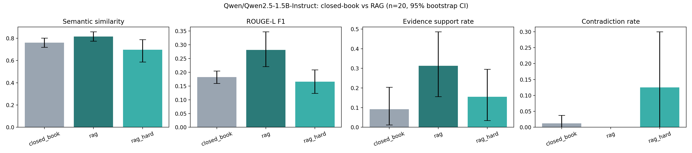

# Does Retrieval Help? Grounding a Small LLM in Trusted Healthcare Guidance

**Research question:** Does giving an LLM relevant passages from trusted healthcare guidance improve the accuracy and evidence support of its answers?

[](https://colab.research.google.com/drive/17rKIWDxjfQF3df_evugIf7R5JWYudy8S?usp=sharing)

> Research project on model behaviour. Nothing generated here is medical advice.

---

## Why this question

Small language models are cheap enough to run anywhere, which makes them attractive for health information tools. They are also fluent enough to be wrong convincingly. Retrieval-augmented generation (RAG) is the standard proposed fix: retrieve trusted passages and make the model answer from them.

This project tests that fix directly rather than assuming it works. The same model answers the same questions three ways, and only the context changes.

## Experimental design

| Condition | What the model sees | Purpose |
|---|---|---|
| **A. Closed-book** | The question only | Baseline: what the model "knows" |
| **B. RAG** | Question + top-3 retrieved guidance passages | The intervention |
| **C. RAG, source removed** | Question + top-3 passages, excluding the document the reference answer came from | Robustness check: does RAG still help when the exact answer is not in the library? |

Same model, same questions and greedy decoding across all three conditions, giving a paired, controlled comparison.

**Hypotheses**
- **H1 (accuracy):** RAG answers are closer to the trusted reference answer than closed-book answers.
- **H2 (evidence support):** A higher share of RAG answer sentences are entailed by trusted guidance, and fewer contradict it.

## Pipeline

```
MedQuAD answers (NIH sources) ──► chunk ──► embed ──► FAISS index
                                                         │
question ─────────────────────────────► retrieve top-k ──┘
    │                                         │
    ├──► LLM (no context)          ──► answer A
    └──► LLM (question + passages) ──► answers B / C
                                              │
evaluate vs. reference: ROUGE-L, semantic similarity,
NLI evidence support & contradiction, citations → paired statistics
```

| Component | Choice |
|---|---|
| Trusted source | MedQuAD: Q&A pairs from 12 NIH websites (MedlinePlus, NCI, GARD and others) |
| Knowledge base | 15,817 unique guidance documents → 39,590 chunks (~120 words, 30-word overlap) |
| Retriever | `BAAI/bge-small-en-v1.5` embeddings + FAISS inner-product index, top-3 |
| Generator | `Qwen/Qwen2.5-1.5B-Instruct`, fp16, greedy decoding, free Colab T4 GPU |
| Accuracy metrics | ROUGE-L F1; semantic similarity with a *separate* embedding model (`all-MiniLM-L6-v2`) so the evaluation does not favour the retriever |
| Evidence metrics | Per-sentence NLI (`cross-encoder/nli-deberta-v3-base`): support rate, contradiction rate, and faithfulness to the passages given |
| Behaviour | Citation rate, abstention rate |
| Statistics | Paired bootstrap 95% CIs, Wilcoxon signed-rank test, Holm correction |

## Results

**Pilot run: n = ⟨20⟩ questions.** Treat these as directional; the full run uses n = ⟨100⟩.

| Metric | Closed-book | RAG | RAG, source removed |
|---|---|---|---|
| Semantic similarity | ⟨ ⟩ | ⟨ ⟩ | ⟨ ⟩ |
| ROUGE-L F1 | ⟨ ⟩ | ⟨ ⟩ | ⟨ ⟩ |
| Evidence support rate | ⟨ ⟩ | ⟨ ⟩ | ⟨ ⟩ |
| Contradiction rate | ⟨ ⟩ | ⟨ ⟩ | ⟨ ⟩ |
| Faithfulness to passages | n/a | ⟨ ⟩ | ⟨ ⟩ |
| Abstention rate | ⟨ ⟩ | ⟨ ⟩ | ⟨ ⟩ |
| Citation rate | n/a | ⟨ ⟩ | ⟨ ⟩ |

Retrieval Recall@3 (reference document in the top 3): **⟨ ⟩%**



<!-- Paste stat_tests.csv here: mean difference, 95% CI and Holm-adjusted p for each metric. -->

## What the examples show

Averages hide the interesting behaviour, so the error analysis looks at the questions where RAG helped and hurt most.

**1. RAG replaced a confident hallucination with a grounded answer.**
Asked what causes Konigsmark-Knox-Hussels syndrome, the closed-book model invented an autoimmune explanation involving the nerves used for swallowing. With retrieval, it identified the OPA1 gene mutation responsible and linked it to hearing and vision loss. Semantic similarity rose from 0.67 to 0.96 and evidence support from 0% to 100%.

**2. A citation is not proof of correctness.**
On the genetics of spastic paraplegia type 4, both conditions named the wrong gene. The closed-book model said PTPRG; the RAG model said PSEN1 and placed it on chromosome 1, then cited passage [1]. SPG4 is caused by mutations in SPAST. The RAG answer *looked* more trustworthy because it carried a citation, which is the more dangerous failure.

**3. Retrieval can make a fluent answer worse.**
For mitochondrial complex III deficiency, the closed-book answer gave a reasonable general definition (similarity 0.87). The RAG answer tried to paraphrase dense passages about mitochondrial versus nuclear DNA and produced a confused statement (similarity 0.75, support 0%). A small model does not always read retrieved text well.

**4. Abstention works when the evidence is missing.**
In condition C, with the source document removed, the model replied that the passages did not contain the information instead of guessing, which is the intended behaviour under the RAG prompt. The same question answered closed-book produced a plausible but unsupported list of symptoms.

**5. The metrics have blind spots.**
On D-2-hydroxyglutaric aciduria, the RAG answer reproduced the reference symptom list closely (similarity 0.83) yet scored 0% evidence support, because a bulleted list splits poorly into sentences for the NLI check. It also added Markdown links the prompt never asked for. Metric results need to be read alongside the answers themselves.

## Findings

<!-- Rewrite once the full-run numbers are in. -->
1. **H1 (accuracy):** ⟨supported / partly supported / not supported⟩. RAG changed semantic similarity by ⟨ ⟩ (95% CI ⟨ ⟩ to ⟨ ⟩).
2. **H2 (evidence support):** ⟨ ⟩. Support rate changed by ⟨ ⟩ percentage points; contradiction rate by ⟨ ⟩.
3. **Robustness:** with the source document removed, the gain ⟨shrank to / held at⟩ ⟨ ⟩, showing how much of RAG's benefit depends on retrieving the exact source.
4. **Retrieval helps most when the model would otherwise invent an answer, and least when the passages are dense or technical.** Grounding is not the same as understanding.

## Limitations

- **Pilot sample size.** n = 20 questions; per-metric estimates carry wide uncertainty.
- **Reference leakage in condition B.** The reference answer sits in the retrieval library, so B is a best case. Condition C exists to address this.
- **Metric validity.** ROUGE rewards copying; NLI models misjudge medical language and list-formatted answers. Blinded human rating of a sample is planned to check how well the automatic metrics track real correctness.
- **One small model, one dataset, one seed.** Results may not transfer to larger models.
- **Source currency.** MedQuAD was collected in the late 2010s; some guidance may be outdated.
- **No clinical validation.** No clinician reviewed the answers.

## Next steps

- Scale to n = 100 and complete the blinded human rating.
- Compare model sizes (1.5B vs 3B): does RAG help smaller models more?
- Vary the number of passages (k = 1, 3, 5).
- Add a distractor condition with irrelevant passages.
- Test out-of-domain retrieval with a different trusted source, such as WHO fact sheets.

## Reproduce

1. Open the notebook in Google Colab.
2. **Runtime → Change runtime type → T4 GPU.**
3. Set `N_QUESTIONS` in the configuration cell and run all cells (about 5 minutes for 20 questions, 30–40 minutes for 100).

All settings are saved to `config.json`. Outputs: `generations.csv`, `results_scored.csv`, `summary.csv`, `stat_tests.csv`, `results.png`.

## Tech stack

Python · PyTorch · Hugging Face Transformers · sentence-transformers · FAISS · rouge-score · SciPy · statsmodels · pandas · Matplotlib · Google Colab (T4 GPU)
